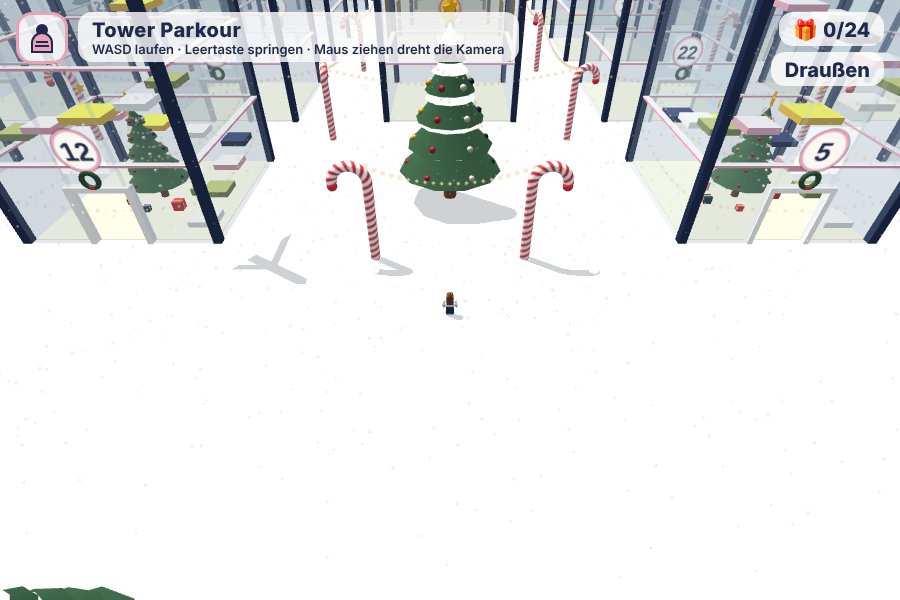
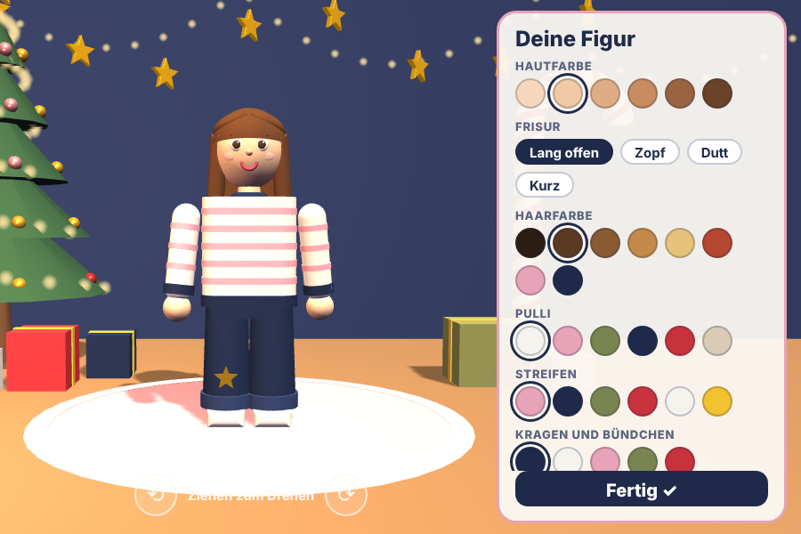
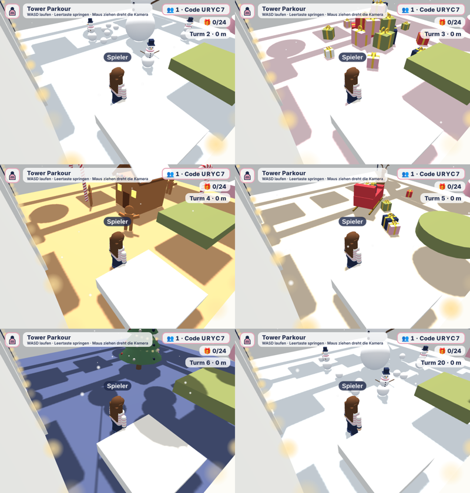
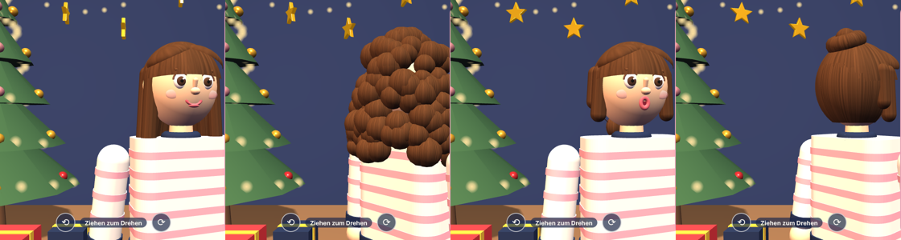
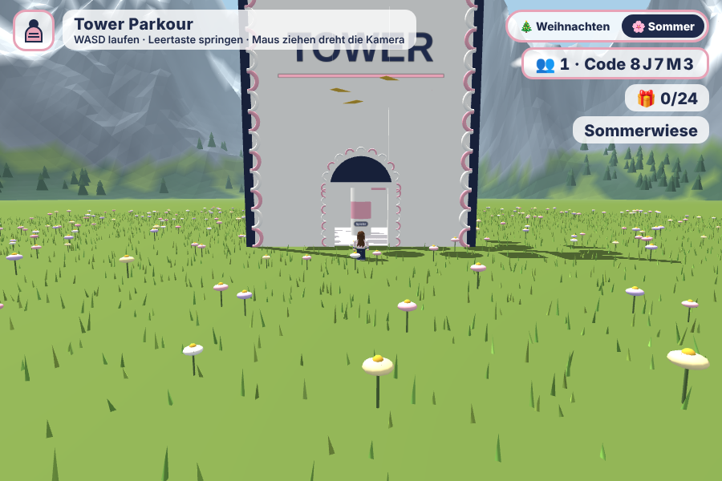
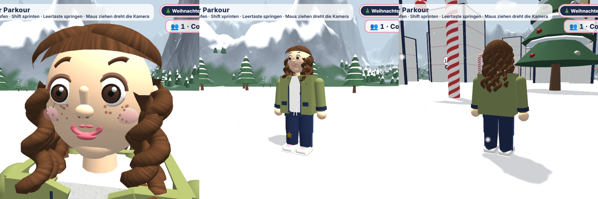

# X-Mas Tower 🎄

Ein 3D-Parkour-Spiel im Browser: ein Adventskalender mit 24 Türmen im Schnee.

- 24 Türme mit Nummern, durcheinander wie bei einem echten Adventskalender. Jeder Turm ist länger als der davor, Turm 24 in der Mitte ist golden und besonders.
- Jeder Turm hat ein eigenes Thema (Tannenbaum, Schneemänner, Geschenkeberg, Lebkuchenhaus, Schlitten mit Rentier, Riesenkugeln), Checkpoints mit Sternen und oben ein Geschenk.
- Verschiedene Blöcke: eckig, rund, drehend, hoch und runter fahrend, schiebend und kleine Trittsteine. Je höher die Turmnummer, desto mehr besondere Blöcke.
- Figur-Editor „Umstyling“ (Knopf oben links, weißer Raum): Name, Mädchen oder Junge, Hautfarbe, Augen, Augenfarbe, Sommersprossen, Mund, Frisur (lang, Locken, Zopf, Dutt, kurz, kurz mit Pony, stachelig), Haarfarbe, Oberteil (Top, Pulli, Jacke mit T-Shirt), Hose (Jeans, Jogginghose, kurze Hose), Stern, Schuhe. Die Figur lässt sich drehen.
- Startbildschirm mit LPlay-App-Logo.
- Zwei Welten (Auswahl oben rechts): die Weihnachtswelt und die Sommerwelt mit Blumenwiese. In der Sommerwelt stehen drei Türme (mit Bögen, Sternen und TOWER-Schild): Dreh-Turm (drehende Plattformen), Hüpf-Turm (Trampoline) und Wackel-Turm (Blöcke wackeln und verschwinden kurz).
- Mit bis zu 6 Leuten spielen über einen Code oben rechts. Läuft über Firebase, also ohne Anmeldung (Spiel: https://yvobe.github.io/x-mas-tower/). Die Regeln für die Datenbank stehen in `database.rules.json`.
- Am besten im Querformat spielen.
- Steuerung: PC mit WASD + Leertaste, Shift zum Sprinten. Handy mit Joystick + Sprung-Knopf + RENN-Knopf.

## Spielen

`index.html` im Browser öffnen. Alles steckt in dieser einen Datei (Three.js wird aus dem Internet geladen).

## Selbst ändern

Ganz oben im Code stehen `LAUF_TEMPO`, `SPRUNG_KRAFT`, `SCHWERKRAFT` und `AUSSEHEN`. Die kannst du ändern wie Variablen in Scratch.

